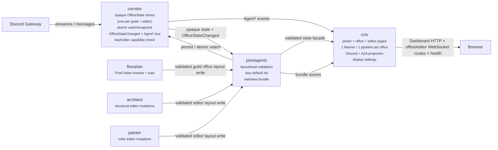
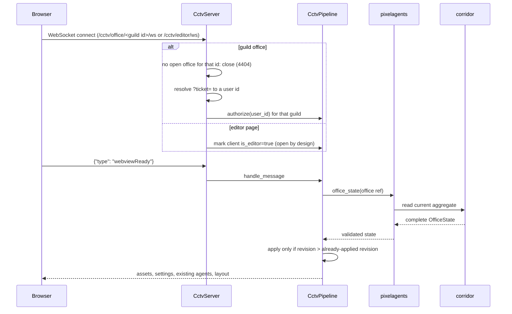
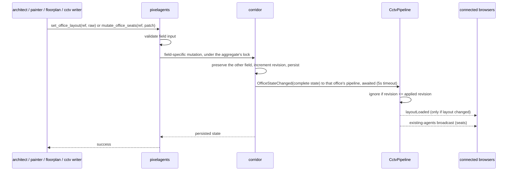
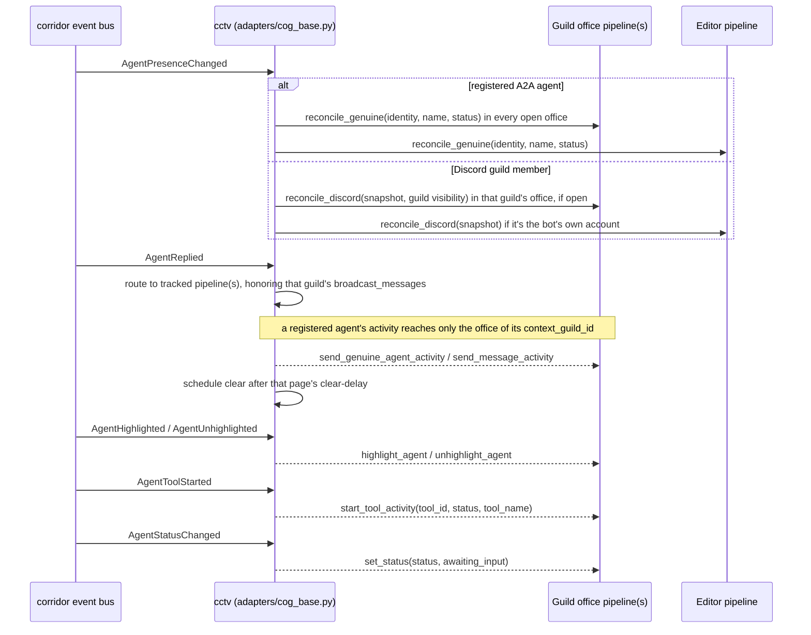
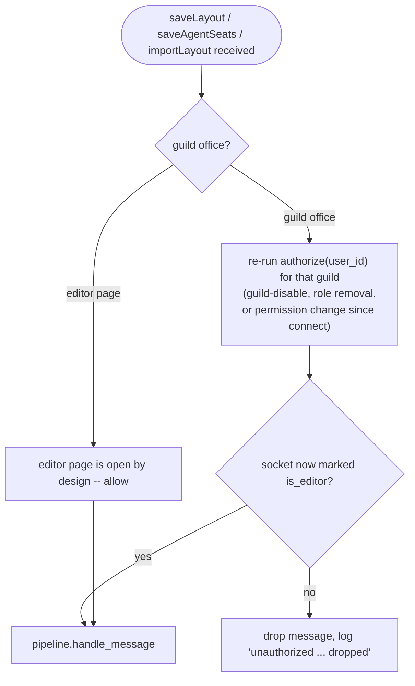
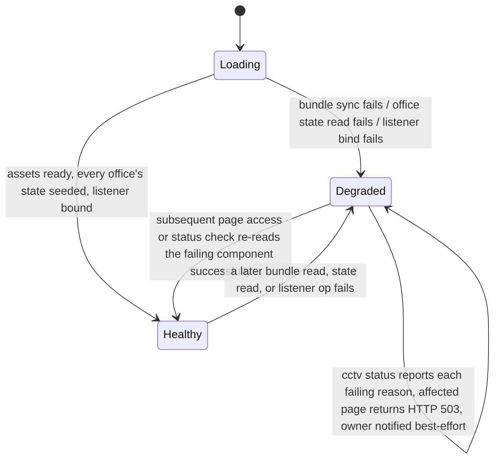

# CCTV design

CCTV owns every browser-facing surface of the Pixel Agents office: the
Dashboard pages (server picker, each guild's office, the editor office),
static asset serving, the WebSocket transport, Discord presence/activity
projection, registered-agent projection, display policy, seat persistence,
and browser authorization. It renders state; it does not own the state's
schema or its persistence.

## Overview

Independent, revisioned "office" aggregates exist side by side:

- one **guild office** per Discord server with CCTV enabled: a presence
  canvas populated from that guild's members plus every registered A2A
  agent, editable only by the bot owner or a keyholder of that guild, and
  the target of a Pixel Index layout load made in that guild;
- the **editor office**, Architect and Painter's shared structural/color
  sandbox, populated from registered A2A agents plus the bot's own Discord
  identity, with an editor deliberately left open to any connected client.

They never merge. Each guild office has its own layout, seats, roster,
WebSocket route and clients: nothing one guild's office shows reaches
another guild's page, socket or API. Loading a Pixel Index layout changes
only the loading guild's office; an Architect structural edit or a Painter
recolor changes only the editor office. CCTV runs one aiohttp listener with
one isolated pipeline per office, so a client of one office can never see
or affect another's state.

## Architecture

Ownership is split cleanly across four cogs. Corridor treats office data as
opaque JSON; Pixelagents is the only schema-aware layer; CCTV renders and
transports; Floorplan, Architect, and Painter write through Pixelagents.



**Corridor** persists every `OfficeState` aggregate (one per guild in
guild-scoped Config, plus the editor's) under a per-aggregate lock, lets a
subscriber watch every aggregate of a kind without missing a write, and publishes
`OfficeStateChanged` synchronously to every subscriber (bounded to a
five-second timeout per subscriber). It also runs the A2A event bus CCTV
subscribes to for presence and activity, and the `keyholder` capability
check CCTV's Discord authorization relies on. Corridor also persists the
office characters (`CharacterRecords`) every office draws. Corridor knows
nothing about what `layout`, `seats` or a character mean.

**Pixelagents** is the schema boundary. It validates guild-office layouts
against the Pixel Agents wire schema, validates editor layouts through the
shared Semantic IR codec and furniture-style manifest, validates and merges
avatar-seat patches, lazily and atomically initializes any aggregate
from the bundled default layout, and delegates persistence/watch calls to
Corridor. It also deals and stores each character's look with the pixatar
CLI it builds from Pixel Index, and builds the static webview bundle CCTV
injects into every page. No consumer bypasses this facade for an office-state
write.

**CCTV** owns rendering and transport only: the Dashboard pages, one
listener with a WebSocket route per guild office plus the editor's and a
health route, per-office client hubs, Discord guild scanning,
registered-agent projection, and the authorization/display-settings policy
layered on top of what Pixelagents and Corridor already validated and
persisted.

Floorplan and Architect keep narrower, non-overlapping roles today:
Floorplan owns Pixel Index API/Web configuration, catalogue browsing, and
loading a selected layout into the invoking guild's office, with no Dashboard
route or WebSocket of its own; Architect owns structural editor-layout
mutations behind its A2A tool loop, with no browser transport at all.
Painter is the same shape as Architect for color-only mutations.

## Domain model

### `OfficeState`

```python
class OfficeStateKind(StrEnum):
    DISCORD = "discord"
    EDITOR = "editor"

@dataclass(frozen=True, slots=True)
class OfficeRef:
    kind: OfficeStateKind
    guild_id: int | None = None   # required for discord, None for editor

@dataclass(frozen=True, slots=True)
class OfficeState:
    kind: OfficeStateKind
    layout: dict[str, Any]        # raw Pixel Agents layout JSON
    seats: dict[str, dict[str, Any]]  # avatar seat-assignment records
    revision: int                 # monotonically increasing per aggregate
    guild_id: int | None = None   # the guild a discord office belongs to
```

`OfficeRef` names one aggregate: `OfficeRef.discord(guild_id)` for a guild's
office, `OfficeRef.editor()` for the editor office; it refuses a discord
office without a guild and an editor office with one. Every office-state
read and write (Corridor, the Pixelagents facade, CCTV, Floorplan,
Architect, Painter) takes an `OfficeRef`. A guild's office lives in
Corridor's guild-scoped Config (`discord_state`); the editor's stays global.

Every aggregate carries layout, seats and revision. `layout` is the raw Pixel Agents
layout JSON (semantic chairs and occupants live here). `seats` is a
separate avatar-placement map -- the seat assignment per agent -- and is
not a duplicate of layout occupancy. (A record can also carry a `palette`
and `repeat`; those are read only when no character roster dresses the
agents, see below.) Each
aggregate initializes lazily and idempotently from the same bundled
default layout the first time any consumer reads or writes it, starting
with an empty `seats` map and revision `1`; whichever caller reaches an
absent aggregate first creates it exactly once. A newly enabled guild's
office therefore starts from the bundled default.

### `CharacterRecords`

```python
CharacterRecords = dict[str, dict[str, Any]]
# "user:<discord user id>" | "agent:<agent key>" ->
#     {"seed": "px.…", "source": "derived" | "custom", "profile": {...}}
```

One map, shared by every office and guild: the look each Discord
account or genuine agent wears. `seed` is a pixatar seed code, `profile`
the Pixel Agents character profile it decodes to. A member who never set a
seed wears the character pixatar deals from their Discord user id
(`source: "derived"`), dealt and stored the first time they are shown; a
genuine agent's is dealt from its agent key. `[p]cctv character set
<px.…>` replaces it with a seed code the member copied from Pixel Index's
character designer (`source: "custom"`), and `[p]cctv character reset`
deals it from the user id again. A member of the corridor `building_manager`
group (or the reserved `owner` group) does the same for any other member,
bots included, with `[p]cctv character memberset <member> <px.…>` /
`memberreset <member>`; the bot's own account is a member like any other,
stored under `user:<bot id>`, the key pico's replies and every office reads.
The bot owner does the same for a registered agent with
`[p]cctv character agentset <agent> <px.…>` / `agentreset`, and an agent's
Discord replies wear its character as their author icon (see
[`docs/reply-identity-design.md`](reply-identity-design.md)). The dealt character is stored, not
re-dealt, because pixatar's free-text deal depends on the wardrobe of the
Pixel Agents commit it was built against, while a seed code always decodes
to the same character. While pixatar can't run (not built yet, or no
Node.js on the host), each character wears one of the built default cast,
chosen by its key so it stays the same one, and nothing is stored.

Pixelagents is the schema boundary here too: it deals, reads and writes the
records (`application/characters.py`), and Corridor persists them under one
lock.

### `OfficeStateChanged`

```python
@dataclass(frozen=True, slots=True)
class OfficeStateChanged:
    state: OfficeState   # complete post-write aggregate, not a diff
```

Every successful layout or seat mutation increments that aggregate's revision
and publishes the *complete* resulting aggregate -- callers never replace
the whole aggregate, so a layout write always preserves the current seats
and a seat write always preserves the current layout. Mutation is
last-write-wins per field: revisions order snapshots and events, they are
not compare-and-set preconditions, and the browser protocol carries no
revision of its own. A pipeline that has already applied a given revision
ignores a duplicate or stale delivery, so redundant delivery is harmless.

### Events table

| Event | Kind | Fields | Notes |
|---|---|---|---|
| `OfficeRef` | value object | `kind`, `guild_id` | Names one aggregate: a guild's office or the editor office. |
| `OfficeState` | value object | `kind`, `layout`, `seats`, `revision`, `guild_id` | The complete, opaque-to-Corridor aggregate for one office. |
| `CharacterRecords` | value object | `seed`, `source`, `profile` per character key | The look each Discord account or genuine agent wears; shared by every office. |
| `OfficeStateChanged` | event | `state: OfficeState` | Published after every successful mutation; each subscriber is awaited with a 5-second timeout, isolated from other subscribers' exceptions. |

`corridor/office_state_catalog.py` generates `corridor/office_state.yaml`,
which CI's office-state contract lint checks against this document; every
name in the table above is load-bearing literal text for that check.

### CCTV settings

```python
@dataclass(frozen=True, slots=True)
class GlobalSettings:
    listener_host: str
    listener_port: int
    discord_clear_delay: float
    editor_clear_delay: float
    designer_url: str
    public_base_url: str | None

@dataclass(frozen=True, slots=True)
class GuildSettings:
    guild_id: int
    enabled: bool
    include_bots: bool
    show_offline: bool
    ghost_offline: bool
    ghost_bots: bool
    broadcast_rich_presence: bool
    broadcast_messages: bool
```

CCTV registers these under its own fresh Red Config identity (no Floorplan
or Architect setting is read into it). Defaults: host `127.0.0.1`, port
`3210`, both clear delays `2.0` seconds, the character designer at
`https://pixel-index-staging.nntin.xyz/assets/design`, no public base URL,
and every guild starts disabled with bots included and drawn translucent,
offline members hidden (drawn translucent once `showoffline` shows them),
and rich-presence and message display on. Guild enablement, include-bots,
offline/ghosting, rich-presence, and message-display settings apply only
to that guild's office; the two activity-clear delays (`discord` for every
guild office, `editor`) are bot-wide. `public_base_url` is the origin
browsers reach the Dashboard at (`[p]cctv publicurl`), from which
`[p]cctv url` builds absolute links: an `https://` origin (or `http://` for
a loopback host) with no path.

Message display shows a member's chat messages from **every** channel the
bot can read, so a viewer of the office may see text from a channel they
can't open in Discord. A guild that doesn't want that turns messages off
with `[p]cctv messages false`; `[p]cctv url` says so whenever they are on.

### Who a guild's office shows

Each enabled guild's roster policy is three settings on top of
`include_bots`, turned into a `pixelagents.domain.OfficeVisibility` on
every reconcile:

| Setting | Command | Default | Effect |
|---|---|---|---|
| `show_offline` | `[p]cctv showoffline <bool>` | off | Show members whose Discord status is offline (or invisible) too |
| `ghost_offline` | `[p]cctv ghostoffline <bool>` | on | Draw those offline members translucent; only consulted with `show_offline` |
| `ghost_bots` | `[p]cctv ghostbots <bool>` | on | Draw bot accounts translucent; off draws them like anyone else |

How a member's presence and translucency reach the canvas, end to end:

1. **Gateway.** corridor's `DiscordGatewayMixin` turns `on_presence_update`
   (status or activities changed), `on_member_update` (display name
   changed) and `on_member_join` into an `AgentPresenceChanged` built by
   `_presence_event`: `status` is `str(member.status)` (forced `"online"`
   for the bot's own account), anything outside online/idle/dnd/offline
   (e.g. `invisible`) becomes `"offline"`, and `is_bot` is `member.bot`.
   `on_member_remove` publishes `status="offline"` with `left_guild=True`.
2. **Subscriber.** `CctvBase._on_agent_presence_changed` resolves an
   `AgentKey`, maps `"offline"` to `AgentSnapshot.status=None`
   (`_event_snapshot`), and, if the guild has an open office (CCTV enabled
   there), calls that office's `reconcile_discord` with the guild's
   `include_bots` and visibility. A
   member who left is reconciled under the default visibility, which
   hides an offline snapshot, so a leaver is removed even where offline
   members show.
3. **Initial sync.** No presence event is needed for a member to appear.
   `cog_load` opens an office for every enabled guild and seeds it from `guild.members`
   (`member_snapshot`, the same status mapping), and once Red is ready
   `_full_sync` runs `OfficeService.sync_guild` over the whole member
   list, which closes characters for members no longer listed and
   reconciles everyone else. Every policy command re-runs `_full_sync`.
4. **Office.** `OfficeService.reconcile` asks the visibility for the
   member's directory (`status.value`, `"offline"` under `show_offline`,
   or None to hide) and whether it's ghosted
   (`is_bot and ghost_bots`, or offline and `ghost_offline`). A hidden or
   excluded bot is closed; a new one is created with `agentCreated`
   (`directoryName`, `isExternal=true`, `isHeadless=<ghosted>`); a change of
   directory *or* of translucency closes and re-creates the character.
   `existingAgents.headlessAgents` repeats each character's last
   `isHeadless`, and bootstrap's `settingsLoaded.ghostHeadlessAgents` is
   always `true`.
5. **Webview.** The vendored webview resolves headless as the explicit
   `isHeadless` when sent (`resolveHeadless` in
   `webview-ui/src/office/engine/headlessAgent.ts`) and draws a headless
   character at `HEADLESS_CHARACTER_ALPHA` only while
   `ghostHeadlessAgents` is on (`renderer.ts`). On this canvas that alpha
   is the flag's only effect (its other use, unlinking a teammate, needs
   team messages this office never sends), so "translucent" and
   "headless" are the same wire value and no upstream change is needed for
   an opaque bot or a translucent human. The webview reads the flag only
   when it creates a character (`syncAgent` on an `existingAgents` resend
   ignores it), which is why step 4 re-creates on a translucency change.

A member in several enabled guilds is a separate character in each guild's
office, wearing that guild's policy and nickname. Registered A2A agents
(genuine agents) are outside this policy: present in every open office,
always translucent while registered, closed when they unregister; an
office opened later seats the agents already registered. The editor page
shows only the bot's own account, under the default policy.

Showing offline members depends on Discord's member cache:

- Without the **presences** intent Discord reports every member as
  offline, so `showoffline` would show everyone as offline.
- Without the **members** intent the cache holds only members seen in an
  event since startup, so offline members who haven't been seen can't be
  shown.
- With it, discord.py chunks every guild at startup; `_full_sync` also
  calls `guild.chunk()` for a guild that isn't chunked yet when
  `showoffline` is on.

`[p]cctv status` shows a **Member Cache** field, and the replies of
`sync`/`enable`/the policy commands carry a warning, whenever one of
these limits applies with `showoffline` on.

### Client wire messages

Every inbound message is parsed by a Pydantic envelope keyed on `type`
(`contracts/websocket.py`); an unrecognized type is dropped, an invalid
payload for a known type raises a logged, connection-preserving error:

| `type` | Direction | Payload | Effect |
|---|---|---|---|
| `authorize` | client to server | `ticket: str` | Guild offices only. Resolves a session ticket to a user id and re-authorizes the socket against that guild. |
| `webviewReady` | client to server | -- | Triggers `bootstrap`: assets, settings, existing agents, and the current layout. |
| `saveLayout` | client to server | `layout: OfficeLayout` | Editor-authorized only. Validated and written through Pixelagents' `set_office_layout`. |
| `saveAgentSeats` | client to server | `seats: {agent_id: {palette?, repeat?, seatId?}}` | Editor-authorized only. Merged through Pixelagents' `mutate_office_seats`; only `seatId` is kept, since the character roster decides what each agent wears. |
| `requestDiagnostics` | client to server | -- | Answered with `agentDiagnostics` and the pipeline's current revision. |
| `importLayout` | client to server | -- | Accepted and intentionally a no-op. |
| `layoutLoaded` | server to client | `layout` | Broadcast only when the layout field of a newly applied state actually changed. |
| `characterProfilesLoaded` | server to client | `profiles`, `agentLooks?` | The character roster: one profile per character shown, named after who wears it (Discord display name or agent name). Sent at bootstrap, and with `agentLooks` (every live agent's `palette`, its place in `profiles`, `repeat` 0) whenever a character is shown, leaves, is renamed or changes its look. |
| `agentDiagnostics` | server to client | `agents: []`, `revision` | Static reply to `requestDiagnostics`. |

`saveLayout`, `saveAgentSeats`, and `importLayout` are gated as writes: the
server drops them unless the sending socket is currently marked as an
editor for that page.

## Key flows

### Client connects and bootstraps



### Live mutation broadcast



A successful persist is never rolled back because a display broadcast
failed or timed out: Corridor releases the persistence lock, then awaits
subscribers, then returns success to the writer regardless of subscriber
outcome. Because every event carries the complete aggregate, the next
event or the client's next `webviewReady` repairs any missed update.

### Agent activity from the event bus



A registered agent's *presence* reaches every office, but its *activity*
(the last four events, and its `AgentReplied`) reaches a guild office only
when the event's `context_guild_id` names that guild -- the guild whose
conversation produced it (see "Which guild a genuine agent's
activity belongs to" in [`docs/corridor-pubsub-design.md`](corridor-pubsub-design.md)).
Activity of unknown origin reaches the editor page alone.

CCTV subscribes to all six of these `Agent*` events at startup in one
atomic `watch_agent_events` call alongside `list_agents()`, then performs
its Discord guild-cache scan without an intervening `await`, so no
presence change occurring during startup can be missed.

## API / command / route reference

### HTTP and WebSocket routes

| Route | Method | Purpose |
|---|---|---|
| `/cctv/office/<guild id>/ws` | WebSocket | One guild office's live connection. An id with no open office (unknown, not a guild, CCTV disabled there) is closed right after the upgrade with code `4404`, the same for every such case |
| `/cctv/editor/ws` | WebSocket | Editor office live connection |
| `/cctv/health` | GET | JSON status snapshot (`status`, `listener`, `assets`, `offices` totals -- open offices, clients, agents, errors -- and `editor` health) for a reverse proxy or uptime monitor; it names no guild |
| `/third-party/cctv` | Dashboard GET | Server picker: every open guild office with its name, icon and live headcount, linking to its office page |
| `/third-party/cctv/office?guild=<guild id>` | Dashboard GET | That guild's office page; one 404 for every id without an open office |
| `/third-party/cctv/discord` | Dashboard GET (hidden) | Redirects to the server picker |
| `/third-party/cctv/editor` | Dashboard GET | Editor office page |
| `/third-party/cctv/session` | Dashboard GET (hidden) | Mints a short-lived ticket for the current Dashboard user |
| `/third-party/cctv/static/<path>` | Dashboard GET/HEAD | Shared webview asset |

The Dashboard renders every page's source as a Jinja template
(`render_template_string`). The office and editor pages inject only a
WebSocket path built from an integer guild id; the picker hands guild names
to its template as data (`cctv_guilds`), never spliced into the source, so
a guild name can't run as template code or markup. Every guild-specific
byte (roster, names, layout, characters, presence, messages) travels only
over that guild's WebSocket; `/third-party/cctv/static/` serves the same
guild-agnostic build to everyone, and must stay that way -- any future
per-guild asset belongs behind a guild-scoped route.

### Commands

| Command | Scope | Description |
|---|---|---|
| `[p]cctv url` | Any member | This server's office link (absolute once `publicurl` is set), with a note that chat messages from every channel show while `messages` is on |
| `[p]cctv status` | Guild admin | Listener, this server's office route/page, assets, this office's and the editor's revision/client counts, guild settings, health |
| `[p]cctv dashboard` | Guild admin | Dashboard readiness and the picker, this server's office, and the editor page links |
| `[p]cctv enable` / `disable` | Guild admin | Open this guild's office and sync its roster / close it, disconnecting its viewers |
| `[p]cctv includebots <bool>` | Guild admin | Include/exclude bot accounts; triggers a full resync if the guild is enabled |
| `[p]cctv showoffline <bool>` | Guild admin | Show/hide offline members (default hidden); triggers a full resync if the guild is enabled |
| `[p]cctv ghostoffline <bool>` | Guild admin | Draw shown offline members translucent (default) or normally; triggers a full resync if the guild is enabled |
| `[p]cctv ghostbots <bool>` | Guild admin | Draw bot accounts translucent (default) or normally; triggers a full resync if the guild is enabled |
| `[p]cctv richpresence <bool>` | Guild admin | Toggle this office's rich-presence display (default on); clears presence immediately when turned off |
| `[p]cctv messages <bool>` | Guild admin | Toggle this office's chat-message bubbles (default on) |
| `[p]cctv sync` | Guild admin | Force a full resync of this guild's roster |
| `[p]cctv despawnall` | Guild admin | Despawn this guild's roster without disabling it |
| `[p]cctv host <host>` | Bot owner | Set listener bind host (validated non-empty, no whitespace); requires reload to rebind |
| `[p]cctv port <port>` | Bot owner | Set listener bind port (1-65535); requires reload to rebind |
| `[p]cctv cleardelay <discord\|editor> <seconds>` | Bot owner | Set the activity-clear delay of every guild office (`discord`) or the editor (>= 0) |
| `[p]cctv designer <url>` | Bot owner | Set the character designer `[p]cctv character` links to |
| `[p]cctv publicurl [url]` | Bot owner | Show or set the origin browsers reach the Dashboard at (`https://…`, no path), which `[p]cctv url` builds links from |
| `[p]cctv character` | Any member | Show your office character: its seed code, avatar, and a designer link that opens it |
| `[p]cctv character set <px.…>` | Any member | Wear the character a seed code stands for; the pages re-dress you live |
| `[p]cctv character reset` | Any member | Go back to the character dealt from your Discord user id |
| `[p]cctv character member <member>` | Building Manager | Show any member's office character, bots and the bot's own account included |
| `[p]cctv character memberset <member> <px.…>` | Building Manager | Dress a member in a seed code's character; the bot's own account also wears it in its Discord replies |
| `[p]cctv character memberreset <member>` | Building Manager | Go back to the character dealt from the member's Discord user id |
| `[p]cctv character agent <agent>` | Bot owner | Show a registered agent's office character (e.g. `architect`) |
| `[p]cctv character agentset <agent> <px.…>` | Bot owner | Dress a registered agent in a seed code's character, on every office and in its Discord replies |
| `[p]cctv character agentreset <agent>` | Bot owner | Go back to the character dealt from the agent's key |

## Validation & error handling

### Guild-office write authorization



Guild-office authorization itself (`_can_edit_guild(guild_id, user_id)`)
allows the bot owner, or a member who satisfies `keyholder` **in that
guild** while CCTV is enabled there -- a keyholder of one guild can't edit
another's office. It fails closed at
every branch: a synthetic or zero user id is rejected outright, and any
exception fetching a guild member or checking the `keyholder` capability is
caught and treated as "not authorized" rather than propagated. A ticket
only proves the browser's identity at connect time; every write re-checks
authorization against current guild/role state rather than trusting the
socket's state from when it opened.

### Degraded startup and page access



None of a listener bind failure, a missing/invalid webview bundle, or an
unreadable/invalid persisted aggregate prevents `cog_load` from completing
or unloads CCTV afterward -- each becomes a health reason instead. A
Dashboard page access retries the underlying bundle/state read on every
request, so a repair (e.g. rebuilding the bundle, fixing a corrupt Config
entry) takes effect on the next request without a bot restart; only the
listener's own bind requires an explicit reload. Corrupt persisted state is
always reported through `[p]cctv status` and the 503 response, never
silently replaced with a default.

### Shutdown

`cog_unload` unsubscribes CCTV from every Corridor event (office-state
watches and the six `Agent*` handlers), cancels every supervised background
task (delayed activity clears, the post-ready guild/bot sync), closes every
office's client sockets, stops the aiohttp listener, and drops every
pipeline -- in that order, so no in-flight event can reach a half-torn-down
pipeline. `[p]cctv disable` closes one guild's office the same way, while
the rest keep running.

## Design rationale

**One listener, one pipeline per office, not a listener per office.**
Every office shares static assets and TCP binding but nothing about live
state: each `CctvPipeline` (one per open guild office in `GuildOffices`,
plus the editor's) owns its own `ClientHub`, `OfficeService`, revision,
and bootstrap lock, and the listener routes each socket to exactly one of
them by the guild id in its path. This keeps the operational surface (one
port, one health endpoint) small while keeping office states impossible
to cross-contaminate in code, not just by convention.

**Guild ids in URLs, not secrets.** An office is addressed by its Discord
server id (`?guild=<id>`, `/cctv/office/<id>/ws`): stable across renames,
needing no slug registry. Ids aren't secret, so nothing relies on them
being unguessable; unknown, disabled and non-guild ids all answer the same
404 page and the same `4404` close, so probing ids doesn't tell which
servers use CCTV.

**Subscribe first, then read.** For the editor office Corridor registers
a subscriber and captures the current aggregate under the same lock, so a
writer landing between those two steps cannot produce an unobservable gap.
Guild offices are one per guild, so CCTV subscribes to every Discord office
at once before any guild office reads its own aggregate: a write landing in
between arrives as an event with a higher revision, and the pipeline's
revision gate keeps whichever is newer. The same pattern is reused for the A2A agent-event
subscription plus `list_agents()`, and CCTV performs its own Discord cache
scan immediately afterward without yielding, closing the startup race
end-to-end rather than only within Corridor.

**Revision-gated re-broadcast of `layoutLoaded`, not "broadcast every
change".** Most revision bumps are seat-only (an agent spawning,
despawning, or getting a seat) and are unrelated to what is
on-screen in the editor. The browser only guards against an incoming
`layoutLoaded` while it has unsaved local edits, and that guard drops the
instant a user hits Save -- before that very save's own write has even
landed. Re-broadcasting `layoutLoaded` on a seat-only bump would race that
window and revert a layout the user just placed; gating the rebroadcast on
an actual layout diff removes the race entirely.

**Last-write-wins per field, not compare-and-set.** The existing browser
protocol carries no revision for a client to echo back, and extending it
was out of scope for this design. Concurrent layout writers can overwrite
one another under this scheme; that is an accepted, understood tradeoff,
not an unhandled case -- revisions exist to order delivery and detect stale
snapshots, not to reject conflicting writes.

**A five-second subscriber timeout scoped to office-state events only.**
Because a writer's persistence completes and its lock releases *before*
subscribers are awaited, a slow or stuck Dashboard cannot block a state
write indefinitely, but it also cannot cause the persisted write itself to
be lost -- worst case, one broadcast is late or dropped, and the next event
or the client's own `webviewReady` catches it up. General `Agent*`
activity-event delivery is intentionally left unbounded, since those events
are not part of the persisted office aggregate and a slow subscriber there
carries no data-loss risk to guard against.

**Fresh Config identity, no migration.** CCTV, Corridor's office-state
repository, Floorplan, and Architect each register their own Config
identifier rather than reading any other cog's prior settings. This keeps
each cog's schema simple and avoids coupling one cog's Config layout to
another's history; any old data under a different identifier is left
alone, not deleted, and remains manually recoverable if ever needed.

**Binding to loopback by default.** The editor page is intentionally open
to any connected client, so keeping the listener's default bind on
`127.0.0.1` means direct host-network exposure is an explicit operator
choice (via reverse proxy), not an accidental default.
