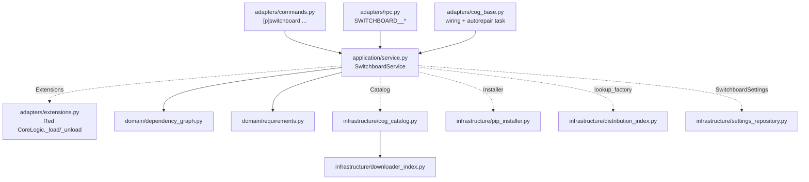
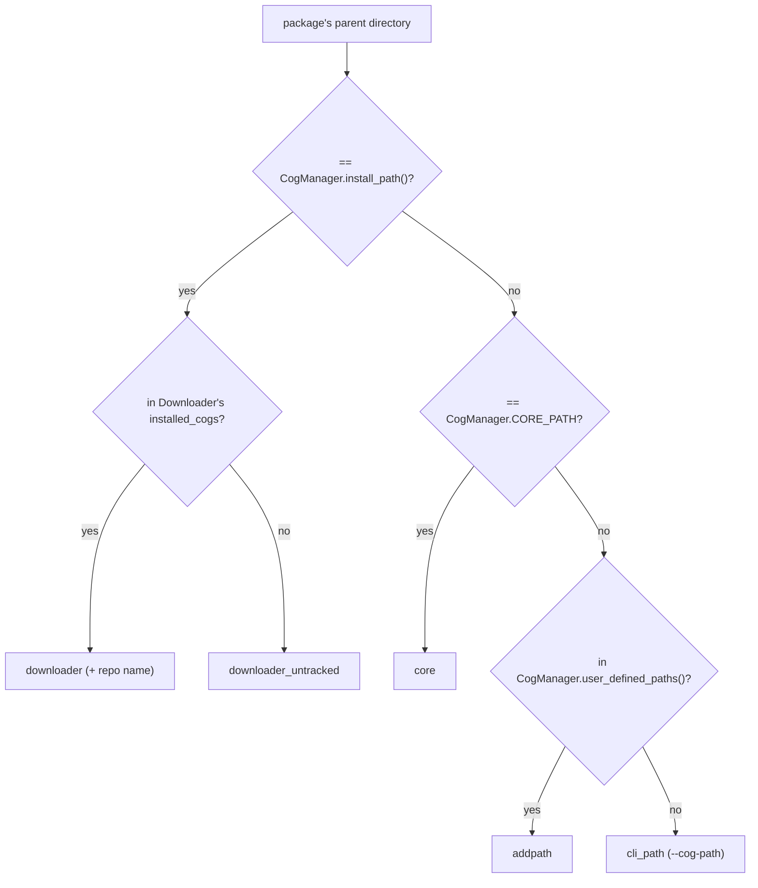

# switchboard architecture

Switchboard follows the repo's standard layering (see
[`pixelagents/Architecture.md`](../pixelagents/Architecture.md)), with one
difference: it imports no other cog. It exists to make corridor loadable,
so `tests/test_adapters.py::TestPackageBoundaries` fails the build on any
import of another office cog, and on any `requirements` or `required_cogs`
in `info.json`.

Dotted edges are Protocols declared in `application/service.py`. CogBase
plugs in the real implementations, and `tests/conftest.py` plugs in
in-memory fakes.

## Layers

- **domain/**: pure logic. It imports no discord or redbot code, only
  `packaging`, which Red itself depends on.
  - `models.py` has the value types and `classify_root()`, which maps a
    cog search path to a `CogSource`.
  - `dependency_graph.py` holds the `required_cogs` closure, the dependents
    of a set, and a deterministic topological load/unload order (ties break
    alphabetically, cycles raise `DependencyCycleError`).
  - `requirements.py` holds `unsatisfied()`: specifiers, markers, extras
    (an extra's own gated `Requires-Dist` lines must be satisfied too) and
    bare-URL requirements.
- **application/service.py**: `SwitchboardService` handles status, install,
  load, unload, reload and repair, plus expanding `all` and directory-name
  tokens. Anything a run installs or loads comes from one catalog scan.
- **infrastructure/**:
  - `cog_catalog.py` scans `CogManager.paths()` in Red's resolution order
    (install path, `--cog-path`, addpath, core). A package is a directory
    with an `__init__.py` whose name is an identifier. `SHARED_LIBRARY`
    packages are skipped.
  - `downloader_index.py` reads Downloader's `installed_cogs` straight from
    its Config (identifier `998240343`). That tells a real `[p]cog install`
    apart from a hand copy, even while the Downloader cog is unloaded.
  - `distribution_index.py` indexes `importlib.metadata` over `sys.path`,
    with the first match winning, which is import precedence.
  - `pip_installer.py` runs Downloader's own
    `python -m pip install -U -t <lib>` once per run, then calls
    `importlib.invalidate_caches()`.
  - `settings_repository.py` holds the global Config: `managed` and
    `autorepair`.
- **adapters/**:
  - `extensions.py` loads and unloads through the Core cog's
    `CoreLogic._load` / `_unload`, the code behind `[p]load` and
    `CORE__LOAD`. So a switchboard load gets Red's module refresh and its
    autoload-list entry. A failure without a reason reports the last line of
    `bot._last_exception`.
  - `commands.py` and `rpc.py` are thin translations into the service.
    `rendering.py` turns reports into chat text and JSON-safe dicts.
  - `cog_base.py` builds the service. In `cog_load` it registers the RPC
    handlers and, if autorepair is on, starts a task that waits for
    `bot.wait_until_red_ready()` and calls `repair()`. The task is
    cancelled in `cog_unload`.

## Resolving where a cog comes from

For a loaded cog, the copy reported is the one its module was loaded from,
which can differ from the copy Red would pick now. Every other copy of the
name is listed as shadowed.

## Ownership

- The only files switchboard writes are pip's output in Downloader's lib
  directory (Red's data directory, never a cog's source tree) and its own
  Config.
- Loaded cogs are recorded in Red's own autoload list (through `_load`) and
  in switchboard's `managed` list. Unloading through switchboard removes a
  cog from both. Unloading through `[p]unload` removes it only from Red's.
